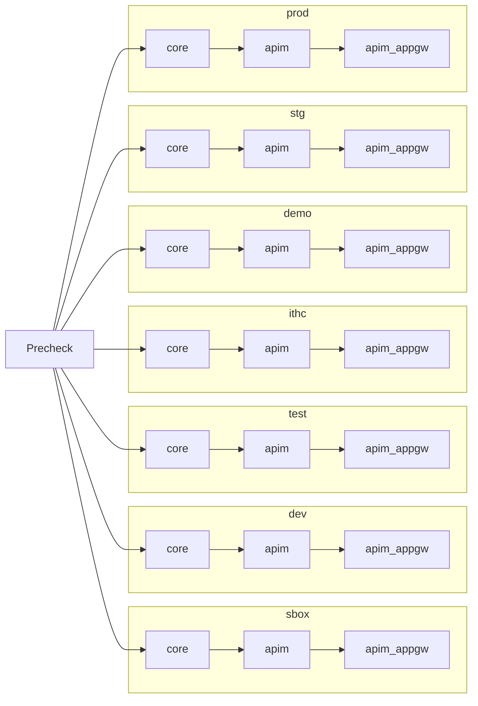

# shared-platform-services-infra

Infrastructure-as-code for the Shared Platform Services (SPS) Azure environment,
managed with Terraform and deployed via Azure DevOps.

## Repository structure

| Path | Purpose |
|---|---|
| `components/` | Terraform components deployed per environment (core, apim, apim_appgw) |
| `environments/` | Per-environment `.tfvars` files |
| `modules/` | Shared local Terraform modules |
| `portal/` | APIM developer portal artifacts, scripts, and documentation |
| `azure-pipeline.yaml` | Azure DevOps pipeline definition |

## Developer portal

APIM developer portal customizations (pages, layouts, styles, media) are managed
separately from the Terraform infrastructure. See [`portal/README.md`](portal/README.md)
for full documentation including:

- How to export portal customizations from a live APIM instance
- Where artifacts are stored and how to commit them
- CI/CD deployment flow (post-APIM Terraform stage)
- Required permissions
- Environment-specific configuration
- Rollback guidance

## Deployment pipeline

Auto-generated from `azure-pipeline.yaml` — shows every `<environment>_<component>` stage and its
dependencies (same-environment component order, plus the environment's `Precheck`/promotion gate).

<!-- BEGIN_PIPELINE_DIAGRAM -->

<!-- END_PIPELINE_DIAGRAM -->

<!-- BEGIN_TF_DOCS -->
### `core`

### Requirements

| Name | Version |
|------|---------|
|  [terraform](#requirement\_terraform) | 1.15.7 |
|  [azurerm](#requirement\_azurerm) | 4.80.0 |
|  [tls](#requirement\_tls) | 4.0.6 |

### Providers

| Name | Version |
|------|---------|
|  [azuread](#provider\_azuread) | n/a |
|  [azurerm](#provider\_azurerm) | 4.80.0 |
|  [azurerm.central-app-kv](#provider\_azurerm.central-app-kv) | 4.80.0 |
|  [tls](#provider\_tls) | 4.0.6 |

### Modules

| Name | Source | Version |
|------|--------|---------|
|  [cross\_tenant\_peering](#module\_cross\_tenant\_peering) | ../../modules/cross-tenant-peering | n/a |
|  [ctags](#module\_ctags) | github.com/hmcts/terraform-module-common-tags | n/a |
|  [networking](#module\_networking) | github.com/hmcts/terraform-module-azure-virtual-networking | 4.x |
|  [vnet\_peer\_hub](#module\_vnet\_peer\_hub) | github.com/hmcts/terraform-module-vnet-peering | master |
|  [vnet\_peer\_vpn](#module\_vnet\_peer\_vpn) | github.com/hmcts/terraform-module-vnet-peering | master |

### Resources

| Name | Type |
|------|------|
| [azurerm_dev_test_global_vm_shutdown_schedule.debug_vm](https://registry.terraform.io/providers/hashicorp/azurerm/4.80.0/docs/resources/dev_test_global_vm_shutdown_schedule) | resource |
| [azurerm_key_vault.extid](https://registry.terraform.io/providers/hashicorp/azurerm/4.80.0/docs/resources/key_vault) | resource |
| [azurerm_key_vault.this](https://registry.terraform.io/providers/hashicorp/azurerm/4.80.0/docs/resources/key_vault) | resource |
| [azurerm_linux_virtual_machine.debug_vm](https://registry.terraform.io/providers/hashicorp/azurerm/4.80.0/docs/resources/linux_virtual_machine) | resource |
| [azurerm_network_interface.debug_vm](https://registry.terraform.io/providers/hashicorp/azurerm/4.80.0/docs/resources/network_interface) | resource |
| [azurerm_resource_group.extid](https://registry.terraform.io/providers/hashicorp/azurerm/4.80.0/docs/resources/resource_group) | resource |
| [azurerm_resource_group.this](https://registry.terraform.io/providers/hashicorp/azurerm/4.80.0/docs/resources/resource_group) | resource |
| [azurerm_role_assignment.debug_vm_admin_login](https://registry.terraform.io/providers/hashicorp/azurerm/4.80.0/docs/resources/role_assignment) | resource |
| [azurerm_role_assignment.private_dns_vnet_join](https://registry.terraform.io/providers/hashicorp/azurerm/4.80.0/docs/resources/role_assignment) | resource |
| [azurerm_role_assignment.rbac](https://registry.terraform.io/providers/hashicorp/azurerm/4.80.0/docs/resources/role_assignment) | resource |
| [azurerm_storage_account.api_state_store](https://registry.terraform.io/providers/hashicorp/azurerm/4.80.0/docs/resources/storage_account) | resource |
| [azurerm_storage_container.api_state_container](https://registry.terraform.io/providers/hashicorp/azurerm/4.80.0/docs/resources/storage_container) | resource |
| [azurerm_virtual_machine_extension.debug_vm_aad_login](https://registry.terraform.io/providers/hashicorp/azurerm/4.80.0/docs/resources/virtual_machine_extension) | resource |
| [tls_private_key.debug_vm](https://registry.terraform.io/providers/hashicorp/tls/4.0.6/docs/resources/private_key) | resource |
| [azuread_group.api_marketplace](https://registry.terraform.io/providers/hashicorp/azuread/latest/docs/data-sources/group) | data source |
| [azurerm_client_config.current](https://registry.terraform.io/providers/hashicorp/azurerm/4.80.0/docs/data-sources/client_config) | data source |
| [azurerm_key_vault.central_app_registration](https://registry.terraform.io/providers/hashicorp/azurerm/4.80.0/docs/data-sources/key_vault) | data source |
| [azurerm_key_vault_secret.multi_tenant_client_id](https://registry.terraform.io/providers/hashicorp/azurerm/4.80.0/docs/data-sources/key_vault_secret) | data source |
| [azurerm_key_vault_secret.multi_tenant_client_secret](https://registry.terraform.io/providers/hashicorp/azurerm/4.80.0/docs/data-sources/key_vault_secret) | data source |
| [azurerm_subscription.current](https://registry.terraform.io/providers/hashicorp/azurerm/4.80.0/docs/data-sources/subscription) | data source |

### Inputs

| Name | Description | Type | Default | Required |
|------|-------------|------|---------|:--------:|
|  [additional\_routes\_apim](#input\_additional\_routes\_apim) | A list of additional routes configurations | <pre>list(object({     name                   = string     address_prefix         = string     next_hop_type          = string     next_hop_in_ip_address = string   }))</pre> | `[]` | no |
|  [apim\_appgw\_backend\_pool\_fqdns](#input\_apim\_appgw\_backend\_pool\_fqdns) | n/a | `list` | `[]` | no |
|  [apim\_appgw\_backend\_pool\_ips](#input\_apim\_appgw\_backend\_pool\_ips) | n/a | `list` | `[]` | no |
|  [apim\_appgw\_exclusions](#input\_apim\_appgw\_exclusions) | n/a | `list` | `[]` | no |
|  [apim\_appgw\_max\_capacity](#input\_apim\_appgw\_max\_capacity) | n/a | `number` | `10` | no |
|  [apim\_appgw\_min\_capacity](#input\_apim\_appgw\_min\_capacity) | n/a | `number` | `2` | no |
|  [apim\_custom\_nsg\_rules](#input\_apim\_custom\_nsg\_rules) | A map of custom NSG rules to apply in addition to the default rules to the APIM NSG | <pre>map(object({     priority                     = number     direction                    = string     access                       = string     protocol                     = string     source_port_range            = optional(string)     source_port_ranges           = optional(list(string))     destination_port_range       = optional(string)     destination_port_ranges      = optional(list(string))     source_address_prefix        = optional(string)     source_address_prefixes      = optional(list(string))     destination_address_prefix   = optional(string)     destination_address_prefixes = optional(list(string))     description                  = optional(string)   }))</pre> | `{}` | no |
|  [apim\_diagnostic\_settings](#input\_apim\_diagnostic\_settings) | Configuration for the APIM Application Insights diagnostic settings | <pre>object({     sampling_percentage          = optional(number, 100)     always_log_errors            = optional(bool, true)     http_correlation_protocol    = optional(string, "W3C")     verbosity                    = optional(string, "information")     frontend_request_body_bytes  = optional(number, 0)     frontend_response_body_bytes = optional(number, 0)     backend_request_body_bytes   = optional(number, 0)     backend_response_body_bytes  = optional(number, 0)   })</pre> | `{}` | no |
|  [apim\_sku\_name](#input\_apim\_sku\_name) | n/a | `string` | `"Developer"` | no |
|  [apim\_subscription\_managers](#input\_apim\_subscription\_managers) | Managed identities granted the custom APIM subscription manager role (list/get/create/delete subscription keys) on the APIM instance. Key is a logical name, value is the identity's principal (object) ID. | `map(string)` | `{}` | no |
|  [autoShutdown](#input\_autoShutdown) | n/a | `bool` | `false` | no |
|  [builtFrom](#input\_builtFrom) | n/a | `string` | n/a | yes |
|  [cross\_tenant\_peering](#input\_cross\_tenant\_peering) | Configuration for cross-tenant VNet peering providers and peering targets. | <pre>object({     # The CNP (hmcts) subscription that contains the SPS VNet to peer from     cnp_subscription_id = optional(string, "bd2864ed-4f3e-45ed-9c6a-8d179674bab1")     # The CPP non-live subscription that contains the target VNet to peer to     cpp_subscription_id = optional(string, "e6b5053b-4c38-4475-a835-a025aeb3d8c7")     # Map of VNet peerings to create — key is a logical name used as the Terraform resource key     peerings = optional(map(object({       source_name = string # Name of the peering link on the CNP/SPS side       target_name = string # Name of the peering link on the CPP side       vnet_name   = string # Name of the target VNet in the CPP subscription       rg_name     = string # Resource group of the target VNet in the CPP subscription     })), {})   })</pre> | `{}` | no |
|  [debug\_vm](#input\_debug\_vm) | Configuration for a temporary Ubuntu VM deployed into the private-endpoints subnet, for troubleshooting cross-tenant/cross-network connectivity. Not deployed by default — set enabled = true per-environment in tfvars. `image` defaults to Ubuntu 26.04 LTS — confirm the offer/sku are still current for the target region (e.g. `az vm image list --publisher Canonical --all --output table`) before relying on the defaults in a new environment. | <pre>object({     enabled = optional(bool, false)     size    = optional(string, "Standard_D2ds_v5")     image = optional(object({       publisher = optional(string, "Canonical")       offer     = optional(string, "ubuntu-26_04-lts")       sku       = optional(string, "server")       version   = optional(string, "latest")     }), {})   })</pre> | `{}` | no |
|  [department](#input\_department) | n/a | `string` | `"sps"` | no |
|  [deploy\_extid\_rg](#input\_deploy\_extid\_rg) | Whether to deploy the external identity resource group | `bool` | `false` | no |
|  [destinations](#input\_destinations) | Declared to satisfy the shared tfvars file; not used directly in components | `map` | `{}` | no |
|  [developer\_portal](#input\_developer\_portal) | Configuration for the APIM developer portal custom domain and certificate | <pre>object({     custom_domain_name = optional(string)     key_vault_id       = optional(string)     cert_name          = optional(string)   })</pre> | `{}` | no |
|  [developers\_group](#input\_developers\_group) | The name of the Azure AD group that will be granted access over infra. | `string` | `"DTS AMp Developers"` | no |
|  [disable\_trusted\_service\_connectivity](#input\_disable\_trusted\_service\_connectivity) | Disable Trusted Service Connectivity for APIM | `bool` | `false` | no |
|  [env](#input\_env) | n/a | `string` | n/a | yes |
|  [expiresAfter](#input\_expiresAfter) | Date when Sandbox resources can be deleted. Format: YYYY-MM-DD | `string` | `"3000-01-01"` | no |
|  [frontends](#input\_frontends) | n/a | `map` | `{}` | no |
|  [gateway\_hostname](#input\_gateway\_hostname) | Configuration for the APIM gateway custom domain and certificate | <pre>object({     key_vault_id       = optional(string)     cert_name          = optional(string)   })</pre> | `{}` | no |
|  [hub\_app\_gw\_private\_ip\_address](#input\_hub\_app\_gw\_private\_ip\_address) | n/a | `list` | `[]` | no |
|  [identity\_provider](#input\_identity\_provider) | Configuration for the APIM identity provider | <pre>object({     app_id_secret_name     = optional(string, "api-marketplace-apim-nonprod-app-id")     app_secret_secret_name = optional(string, "api-marketplace-apim-nonprod-secret")   })</pre> | `{}` | no |
|  [key\_vault\_subscription](#input\_key\_vault\_subscription) | n/a | `any` | `null` | no |
|  [location](#input\_location) | n/a | `string` | `"UK South"` | no |
|  [management](#input\_management) | Configuration for the APIM management custom domain and certificate | <pre>object({     custom_domain_name = optional(string)     key_vault_id       = optional(string)     cert_name          = optional(string)   })</pre> | `{}` | no |
|  [networking](#input\_networking) | Networking configuration for the virtual network. | <pre>object({     hub = optional(object({       next_hop_ip         = optional(string, "10.11.72.36")       subscription_id     = optional(string, "fb084706-583f-4c9a-bdab-949aac66ba5c")       vnet_name           = optional(string, "hmcts-hub-nonprodi")       resource_group_name = optional(string, "hmcts-hub-nonprodi")     }))     vpn = optional(object({       subscription_id     = optional(string, "ed302caf-ec27-4c64-a05e-85731c3ce90e")       vnet_name           = optional(string, "mgmt-vpn-2-vnet")       resource_group_name = optional(string, "mgmt-vpn-2-mgmt")     }))   })</pre> | <pre>{   "hub": {},   "vpn": {} }</pre> | no |
|  [private\_ip\_address](#input\_private\_ip\_address) | n/a | `string` | `""` | no |
|  [product](#input\_product) | n/a | `string` | n/a | yes |
|  [project](#input\_project) | n/a | `any` | n/a | yes |
|  [publisher\_email](#input\_publisher\_email) | The email address of the APIM publisher. | `string` | `"DTSPlatformOperations@justice.gov.uk"` | no |
|  [send\_access\_logs\_to\_log\_analytics](#input\_send\_access\_logs\_to\_log\_analytics) | Whether to send access logs to log analytics workspace | `bool` | `false` | no |
|  [ssl\_mode](#input\_ssl\_mode) | n/a | `string` | `"FrontDoor"` | no |
|  [ssl\_policy](#input\_ssl\_policy) | n/a | `any` | `null` | no |
|  [subscription](#input\_subscription) | n/a | `any` | n/a | yes |
|  [waf\_mode](#input\_waf\_mode) | n/a | `string` | `"Detection"` | no |

### Outputs

| Name | Description |
|------|-------------|
|  [resource\_group](#output\_resource\_group) | n/a |
|  [subnet\_ids](#output\_subnet\_ids) | n/a |
|  [vnet\_id](#output\_vnet\_id) | n/a |

### `apim`

### Requirements

| Name | Version |
|------|---------|
|  [terraform](#requirement\_terraform) | >= 1.11.1, < 2.0.0 |
|  [azapi](#requirement\_azapi) | >= 1.0 |
|  [azurerm](#requirement\_azurerm) | 4.80.0 |

### Providers

| Name | Version |
|------|---------|
|  [azurerm](#provider\_azurerm) | 4.80.0 |
|  [azurerm.central-app-kv](#provider\_azurerm.central-app-kv) | 4.80.0 |

### Modules

| Name | Source | Version |
|------|--------|---------|
|  [api-mgmt](#module\_api-mgmt) | git::https://github.com/hmcts/cnp-module-api-mgmt-private.git | change/top_level_domain |
|  [ctags](#module\_ctags) | git::https://github.com/hmcts/terraform-module-common-tags.git | master |

### Resources

| Name | Type |
|------|------|
| [azurerm_api_management_identity_provider_aad.entra_id](https://registry.terraform.io/providers/hashicorp/azurerm/4.80.0/docs/resources/api_management_identity_provider_aad) | resource |
| [azurerm_api_management_named_value.environment](https://registry.terraform.io/providers/hashicorp/azurerm/4.80.0/docs/resources/api_management_named_value) | resource |
| [azurerm_role_assignment.apim_subscription_manager](https://registry.terraform.io/providers/hashicorp/azurerm/4.80.0/docs/resources/role_assignment) | resource |
| [azurerm_role_definition.apim_subscription_manager](https://registry.terraform.io/providers/hashicorp/azurerm/4.80.0/docs/resources/role_definition) | resource |
| [azurerm_key_vault.central_app_registration](https://registry.terraform.io/providers/hashicorp/azurerm/4.80.0/docs/data-sources/key_vault) | data source |
| [azurerm_key_vault.this](https://registry.terraform.io/providers/hashicorp/azurerm/4.80.0/docs/data-sources/key_vault) | data source |
| [azurerm_key_vault_certificate.certificate](https://registry.terraform.io/providers/hashicorp/azurerm/4.80.0/docs/data-sources/key_vault_certificate) | data source |
| [azurerm_key_vault_certificate.portal](https://registry.terraform.io/providers/hashicorp/azurerm/4.80.0/docs/data-sources/key_vault_certificate) | data source |
| [azurerm_key_vault_secret.base64_cpp_intermediate_ca](https://registry.terraform.io/providers/hashicorp/azurerm/4.80.0/docs/data-sources/key_vault_secret) | data source |
| [azurerm_key_vault_secret.base64_cpp_root_ca](https://registry.terraform.io/providers/hashicorp/azurerm/4.80.0/docs/data-sources/key_vault_secret) | data source |
| [azurerm_key_vault_secret.entra_id_app_id](https://registry.terraform.io/providers/hashicorp/azurerm/4.80.0/docs/data-sources/key_vault_secret) | data source |
| [azurerm_key_vault_secret.entra_id_app_secret](https://registry.terraform.io/providers/hashicorp/azurerm/4.80.0/docs/data-sources/key_vault_secret) | data source |
| [azurerm_key_vault_secret.entra_id_tenant_id](https://registry.terraform.io/providers/hashicorp/azurerm/4.80.0/docs/data-sources/key_vault_secret) | data source |

### Inputs

| Name | Description | Type | Default | Required |
|------|-------------|------|---------|:--------:|
|  [additional\_routes\_apim](#input\_additional\_routes\_apim) | A list of additional routes configurations | <pre>list(object({     name                   = string     address_prefix         = string     next_hop_type          = string     next_hop_in_ip_address = string   }))</pre> | `[]` | no |
|  [apim\_appgw\_backend\_pool\_fqdns](#input\_apim\_appgw\_backend\_pool\_fqdns) | n/a | `list` | `[]` | no |
|  [apim\_appgw\_backend\_pool\_ips](#input\_apim\_appgw\_backend\_pool\_ips) | n/a | `list` | `[]` | no |
|  [apim\_appgw\_exclusions](#input\_apim\_appgw\_exclusions) | n/a | `list` | `[]` | no |
|  [apim\_appgw\_max\_capacity](#input\_apim\_appgw\_max\_capacity) | n/a | `number` | `10` | no |
|  [apim\_appgw\_min\_capacity](#input\_apim\_appgw\_min\_capacity) | n/a | `number` | `2` | no |
|  [apim\_custom\_nsg\_rules](#input\_apim\_custom\_nsg\_rules) | A map of custom NSG rules to apply in addition to the default rules to the APIM NSG | <pre>map(object({     priority                     = number     direction                    = string     access                       = string     protocol                     = string     source_port_range            = optional(string)     source_port_ranges           = optional(list(string))     destination_port_range       = optional(string)     destination_port_ranges      = optional(list(string))     source_address_prefix        = optional(string)     source_address_prefixes      = optional(list(string))     destination_address_prefix   = optional(string)     destination_address_prefixes = optional(list(string))     description                  = optional(string)   }))</pre> | `{}` | no |
|  [apim\_diagnostic\_settings](#input\_apim\_diagnostic\_settings) | Configuration for the APIM Application Insights diagnostic settings | <pre>object({     sampling_percentage          = optional(number, 100)     always_log_errors            = optional(bool, true)     http_correlation_protocol    = optional(string, "W3C")     verbosity                    = optional(string, "information")     frontend_request_body_bytes  = optional(number, 0)     frontend_response_body_bytes = optional(number, 0)     backend_request_body_bytes   = optional(number, 0)     backend_response_body_bytes  = optional(number, 0)   })</pre> | `{}` | no |
|  [apim\_sku\_name](#input\_apim\_sku\_name) | n/a | `string` | `"Developer"` | no |
|  [apim\_subscription\_managers](#input\_apim\_subscription\_managers) | Managed identities granted the custom APIM subscription manager role (list/get/create/delete subscription keys) on the APIM instance. Key is a logical name, value is the identity's principal (object) ID. | `map(string)` | `{}` | no |
|  [autoShutdown](#input\_autoShutdown) | n/a | `bool` | `false` | no |
|  [builtFrom](#input\_builtFrom) | n/a | `string` | n/a | yes |
|  [cross\_tenant\_peering](#input\_cross\_tenant\_peering) | Configuration for cross-tenant VNet peering providers and peering targets. | <pre>object({     # The CNP (hmcts) subscription that contains the SPS VNet to peer from     cnp_subscription_id = optional(string, "bd2864ed-4f3e-45ed-9c6a-8d179674bab1")     # The CPP non-live subscription that contains the target VNet to peer to     cpp_subscription_id = optional(string, "e6b5053b-4c38-4475-a835-a025aeb3d8c7")     # Map of VNet peerings to create — key is a logical name used as the Terraform resource key     peerings = optional(map(object({       source_name = string # Name of the peering link on the CNP/SPS side       target_name = string # Name of the peering link on the CPP side       vnet_name   = string # Name of the target VNet in the CPP subscription       rg_name     = string # Resource group of the target VNet in the CPP subscription     })), {})   })</pre> | `{}` | no |
|  [debug\_vm](#input\_debug\_vm) | Configuration for a temporary Ubuntu VM deployed into the private-endpoints subnet, for troubleshooting cross-tenant/cross-network connectivity. Not deployed by default — set enabled = true per-environment in tfvars. `image` defaults to Ubuntu 26.04 LTS — confirm the offer/sku are still current for the target region (e.g. `az vm image list --publisher Canonical --all --output table`) before relying on the defaults in a new environment. | <pre>object({     enabled = optional(bool, false)     size    = optional(string, "Standard_D2ds_v5")     image = optional(object({       publisher = optional(string, "Canonical")       offer     = optional(string, "ubuntu-26_04-lts")       sku       = optional(string, "server")       version   = optional(string, "latest")     }), {})   })</pre> | `{}` | no |
|  [department](#input\_department) | n/a | `string` | `"sps"` | no |
|  [deploy\_extid\_rg](#input\_deploy\_extid\_rg) | Whether to deploy the external identity resource group | `bool` | `false` | no |
|  [destinations](#input\_destinations) | Declared to satisfy the shared tfvars file; not used directly in components | `map` | `{}` | no |
|  [developer\_portal](#input\_developer\_portal) | Configuration for the APIM developer portal custom domain and certificate | <pre>object({     custom_domain_name = optional(string)     key_vault_id       = optional(string)     cert_name          = optional(string)   })</pre> | `{}` | no |
|  [developers\_group](#input\_developers\_group) | The name of the Azure AD group that will be granted access over infra. | `string` | `"DTS AMp Developers"` | no |
|  [disable\_trusted\_service\_connectivity](#input\_disable\_trusted\_service\_connectivity) | Disable Trusted Service Connectivity for APIM | `bool` | `false` | no |
|  [env](#input\_env) | n/a | `string` | n/a | yes |
|  [expiresAfter](#input\_expiresAfter) | Date when Sandbox resources can be deleted. Format: YYYY-MM-DD | `string` | `"3000-01-01"` | no |
|  [frontends](#input\_frontends) | n/a | `map` | `{}` | no |
|  [gateway\_hostname](#input\_gateway\_hostname) | Configuration for the APIM gateway custom domain and certificate | <pre>object({     key_vault_id       = optional(string)     cert_name          = optional(string)   })</pre> | `{}` | no |
|  [hub\_app\_gw\_private\_ip\_address](#input\_hub\_app\_gw\_private\_ip\_address) | n/a | `list` | `[]` | no |
|  [identity\_provider](#input\_identity\_provider) | Configuration for the APIM identity provider | <pre>object({     app_id_secret_name     = optional(string, "api-marketplace-apim-nonprod-app-id")     app_secret_secret_name = optional(string, "api-marketplace-apim-nonprod-secret")   })</pre> | `{}` | no |
|  [key\_vault\_subscription](#input\_key\_vault\_subscription) | n/a | `any` | `null` | no |
|  [location](#input\_location) | n/a | `string` | `"UK South"` | no |
|  [management](#input\_management) | Configuration for the APIM management custom domain and certificate | <pre>object({     custom_domain_name = optional(string)     key_vault_id       = optional(string)     cert_name          = optional(string)   })</pre> | `{}` | no |
|  [networking](#input\_networking) | Networking configuration for the virtual network. | <pre>object({     hub = optional(object({       next_hop_ip         = optional(string, "10.11.72.36")       subscription_id     = optional(string, "fb084706-583f-4c9a-bdab-949aac66ba5c")       vnet_name           = optional(string, "hmcts-hub-nonprodi")       resource_group_name = optional(string, "hmcts-hub-nonprodi")     }))     vpn = optional(object({       subscription_id     = optional(string, "ed302caf-ec27-4c64-a05e-85731c3ce90e")       vnet_name           = optional(string, "mgmt-vpn-2-vnet")       resource_group_name = optional(string, "mgmt-vpn-2-mgmt")     }))   })</pre> | <pre>{   "hub": {},   "vpn": {} }</pre> | no |
|  [private\_ip\_address](#input\_private\_ip\_address) | n/a | `string` | `""` | no |
|  [product](#input\_product) | n/a | `string` | n/a | yes |
|  [project](#input\_project) | n/a | `any` | n/a | yes |
|  [publisher\_email](#input\_publisher\_email) | The email address of the APIM publisher. | `string` | `"DTSPlatformOperations@justice.gov.uk"` | no |
|  [send\_access\_logs\_to\_log\_analytics](#input\_send\_access\_logs\_to\_log\_analytics) | Whether to send access logs to log analytics workspace | `bool` | `false` | no |
|  [ssl\_mode](#input\_ssl\_mode) | n/a | `string` | `"FrontDoor"` | no |
|  [ssl\_policy](#input\_ssl\_policy) | n/a | `any` | `null` | no |
|  [subscription](#input\_subscription) | n/a | `any` | n/a | yes |
|  [waf\_mode](#input\_waf\_mode) | n/a | `string` | `"Detection"` | no |

### Outputs

| Name | Description |
|------|-------------|
|  [apim\_name](#output\_apim\_name) | The name of the APIM service. Used by the portal deployment pipeline stage. |
|  [resource\_group\_name](#output\_resource\_group\_name) | The resource group containing the APIM service. Used by the portal deployment pipeline stage. |

### `apim_appgw`

### Requirements

| Name | Version |
|------|---------|
|  [terraform](#requirement\_terraform) | >= 1.11.1, < 2.0.0 |
|  [azurerm](#requirement\_azurerm) | 4.80.0 |

### Providers

| Name | Version |
|------|---------|
|  [azurerm](#provider\_azurerm) | 4.80.0 |
|  [external](#provider\_external) | n/a |

### Modules

| Name | Source | Version |
|------|--------|---------|
|  [app-gw](#module\_app-gw) | git::https://github.com/hmcts/terraform-module-apim-application-gateway.git | DTSPO-31984-waf-changes |
|  [ctags](#module\_ctags) | git::https://github.com/hmcts/terraform-module-common-tags.git | master |
|  [logworkspace](#module\_logworkspace) | git::https://github.com/hmcts/terraform-module-log-analytics-workspace-id.git | master |

### Resources

| Name | Type |
|------|------|
| [azurerm_subscription.current](https://registry.terraform.io/providers/hashicorp/azurerm/4.80.0/docs/data-sources/subscription) | data source |
| [external_external.bash_script](https://registry.terraform.io/providers/hashicorp/external/latest/docs/data-sources/external) | data source |

### Inputs

| Name | Description | Type | Default | Required |
|------|-------------|------|---------|:--------:|
|  [additional\_routes\_apim](#input\_additional\_routes\_apim) | A list of additional routes configurations | <pre>list(object({     name                   = string     address_prefix         = string     next_hop_type          = string     next_hop_in_ip_address = string   }))</pre> | `[]` | no |
|  [apim\_appgw\_backend\_pool\_fqdns](#input\_apim\_appgw\_backend\_pool\_fqdns) | n/a | `list` | `[]` | no |
|  [apim\_appgw\_backend\_pool\_ips](#input\_apim\_appgw\_backend\_pool\_ips) | n/a | `list` | `[]` | no |
|  [apim\_appgw\_exclusions](#input\_apim\_appgw\_exclusions) | n/a | `list` | `[]` | no |
|  [apim\_appgw\_max\_capacity](#input\_apim\_appgw\_max\_capacity) | n/a | `number` | `10` | no |
|  [apim\_appgw\_min\_capacity](#input\_apim\_appgw\_min\_capacity) | n/a | `number` | `2` | no |
|  [apim\_custom\_nsg\_rules](#input\_apim\_custom\_nsg\_rules) | A map of custom NSG rules to apply in addition to the default rules to the APIM NSG | <pre>map(object({     priority                     = number     direction                    = string     access                       = string     protocol                     = string     source_port_range            = optional(string)     source_port_ranges           = optional(list(string))     destination_port_range       = optional(string)     destination_port_ranges      = optional(list(string))     source_address_prefix        = optional(string)     source_address_prefixes      = optional(list(string))     destination_address_prefix   = optional(string)     destination_address_prefixes = optional(list(string))     description                  = optional(string)   }))</pre> | `{}` | no |
|  [apim\_diagnostic\_settings](#input\_apim\_diagnostic\_settings) | Configuration for the APIM Application Insights diagnostic settings | <pre>object({     sampling_percentage          = optional(number, 100)     always_log_errors            = optional(bool, true)     http_correlation_protocol    = optional(string, "W3C")     verbosity                    = optional(string, "information")     frontend_request_body_bytes  = optional(number, 0)     frontend_response_body_bytes = optional(number, 0)     backend_request_body_bytes   = optional(number, 0)     backend_response_body_bytes  = optional(number, 0)   })</pre> | `{}` | no |
|  [apim\_sku\_name](#input\_apim\_sku\_name) | n/a | `string` | `"Developer"` | no |
|  [apim\_subscription\_managers](#input\_apim\_subscription\_managers) | Managed identities granted the custom APIM subscription manager role (list/get/create/delete subscription keys) on the APIM instance. Key is a logical name, value is the identity's principal (object) ID. | `map(string)` | `{}` | no |
|  [autoShutdown](#input\_autoShutdown) | n/a | `bool` | `false` | no |
|  [builtFrom](#input\_builtFrom) | n/a | `string` | n/a | yes |
|  [cross\_tenant\_peering](#input\_cross\_tenant\_peering) | Configuration for cross-tenant VNet peering providers and peering targets. | <pre>object({     # The CNP (hmcts) subscription that contains the SPS VNet to peer from     cnp_subscription_id = optional(string, "bd2864ed-4f3e-45ed-9c6a-8d179674bab1")     # The CPP non-live subscription that contains the target VNet to peer to     cpp_subscription_id = optional(string, "e6b5053b-4c38-4475-a835-a025aeb3d8c7")     # Map of VNet peerings to create — key is a logical name used as the Terraform resource key     peerings = optional(map(object({       source_name = string # Name of the peering link on the CNP/SPS side       target_name = string # Name of the peering link on the CPP side       vnet_name   = string # Name of the target VNet in the CPP subscription       rg_name     = string # Resource group of the target VNet in the CPP subscription     })), {})   })</pre> | `{}` | no |
|  [debug\_vm](#input\_debug\_vm) | Configuration for a temporary Ubuntu VM deployed into the private-endpoints subnet, for troubleshooting cross-tenant/cross-network connectivity. Not deployed by default — set enabled = true per-environment in tfvars. `image` defaults to Ubuntu 26.04 LTS — confirm the offer/sku are still current for the target region (e.g. `az vm image list --publisher Canonical --all --output table`) before relying on the defaults in a new environment. | <pre>object({     enabled = optional(bool, false)     size    = optional(string, "Standard_D2ds_v5")     image = optional(object({       publisher = optional(string, "Canonical")       offer     = optional(string, "ubuntu-26_04-lts")       sku       = optional(string, "server")       version   = optional(string, "latest")     }), {})   })</pre> | `{}` | no |
|  [department](#input\_department) | n/a | `string` | `"sps"` | no |
|  [deploy\_extid\_rg](#input\_deploy\_extid\_rg) | Whether to deploy the external identity resource group | `bool` | `false` | no |
|  [destinations](#input\_destinations) | Declared to satisfy the shared tfvars file; not used directly in components | `map` | `{}` | no |
|  [developer\_portal](#input\_developer\_portal) | Configuration for the APIM developer portal custom domain and certificate | <pre>object({     custom_domain_name = optional(string)     key_vault_id       = optional(string)     cert_name          = optional(string)   })</pre> | `{}` | no |
|  [developers\_group](#input\_developers\_group) | The name of the Azure AD group that will be granted access over infra. | `string` | `"DTS AMp Developers"` | no |
|  [disable\_trusted\_service\_connectivity](#input\_disable\_trusted\_service\_connectivity) | Disable Trusted Service Connectivity for APIM | `bool` | `false` | no |
|  [env](#input\_env) | n/a | `string` | n/a | yes |
|  [expiresAfter](#input\_expiresAfter) | Date when Sandbox resources can be deleted. Format: YYYY-MM-DD | `string` | `"3000-01-01"` | no |
|  [frontends](#input\_frontends) | n/a | `map` | `{}` | no |
|  [gateway\_hostname](#input\_gateway\_hostname) | Configuration for the APIM gateway custom domain and certificate | <pre>object({     key_vault_id       = optional(string)     cert_name          = optional(string)   })</pre> | `{}` | no |
|  [hub\_app\_gw\_private\_ip\_address](#input\_hub\_app\_gw\_private\_ip\_address) | n/a | `list` | `[]` | no |
|  [identity\_provider](#input\_identity\_provider) | Configuration for the APIM identity provider | <pre>object({     app_id_secret_name     = optional(string, "api-marketplace-apim-nonprod-app-id")     app_secret_secret_name = optional(string, "api-marketplace-apim-nonprod-secret")   })</pre> | `{}` | no |
|  [key\_vault\_subscription](#input\_key\_vault\_subscription) | n/a | `any` | `null` | no |
|  [location](#input\_location) | n/a | `string` | `"UK South"` | no |
|  [management](#input\_management) | Configuration for the APIM management custom domain and certificate | <pre>object({     custom_domain_name = optional(string)     key_vault_id       = optional(string)     cert_name          = optional(string)   })</pre> | `{}` | no |
|  [networking](#input\_networking) | Networking configuration for the virtual network. | <pre>object({     hub = optional(object({       next_hop_ip         = optional(string, "10.11.72.36")       subscription_id     = optional(string, "fb084706-583f-4c9a-bdab-949aac66ba5c")       vnet_name           = optional(string, "hmcts-hub-nonprodi")       resource_group_name = optional(string, "hmcts-hub-nonprodi")     }))     vpn = optional(object({       subscription_id     = optional(string, "ed302caf-ec27-4c64-a05e-85731c3ce90e")       vnet_name           = optional(string, "mgmt-vpn-2-vnet")       resource_group_name = optional(string, "mgmt-vpn-2-mgmt")     }))   })</pre> | <pre>{   "hub": {},   "vpn": {} }</pre> | no |
|  [private\_ip\_address](#input\_private\_ip\_address) | n/a | `string` | `""` | no |
|  [product](#input\_product) | n/a | `string` | n/a | yes |
|  [project](#input\_project) | n/a | `any` | n/a | yes |
|  [publisher\_email](#input\_publisher\_email) | The email address of the APIM publisher. | `string` | `"DTSPlatformOperations@justice.gov.uk"` | no |
|  [send\_access\_logs\_to\_log\_analytics](#input\_send\_access\_logs\_to\_log\_analytics) | Whether to send access logs to log analytics workspace | `bool` | `false` | no |
|  [ssl\_mode](#input\_ssl\_mode) | n/a | `string` | `"FrontDoor"` | no |
|  [ssl\_policy](#input\_ssl\_policy) | n/a | `any` | `null` | no |
|  [subscription](#input\_subscription) | n/a | `any` | n/a | yes |
|  [waf\_mode](#input\_waf\_mode) | n/a | `string` | `"Detection"` | no |

### Outputs

No outputs.

<!-- END_TF_DOCS -->
